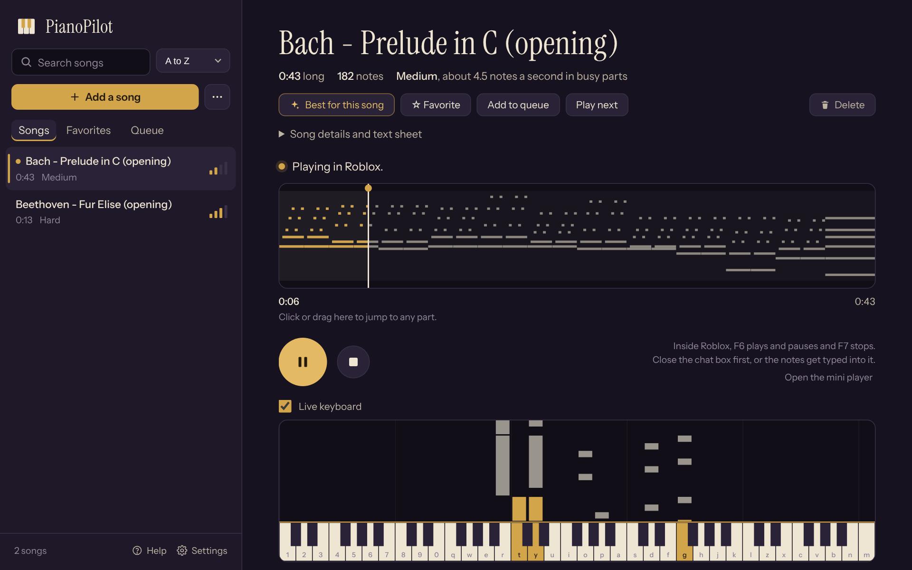
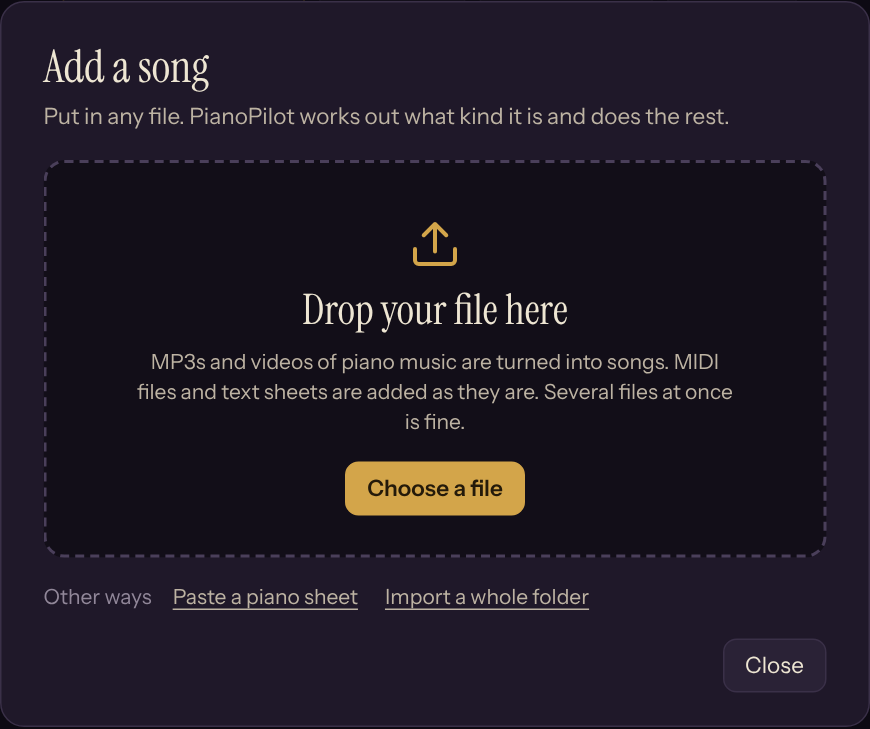
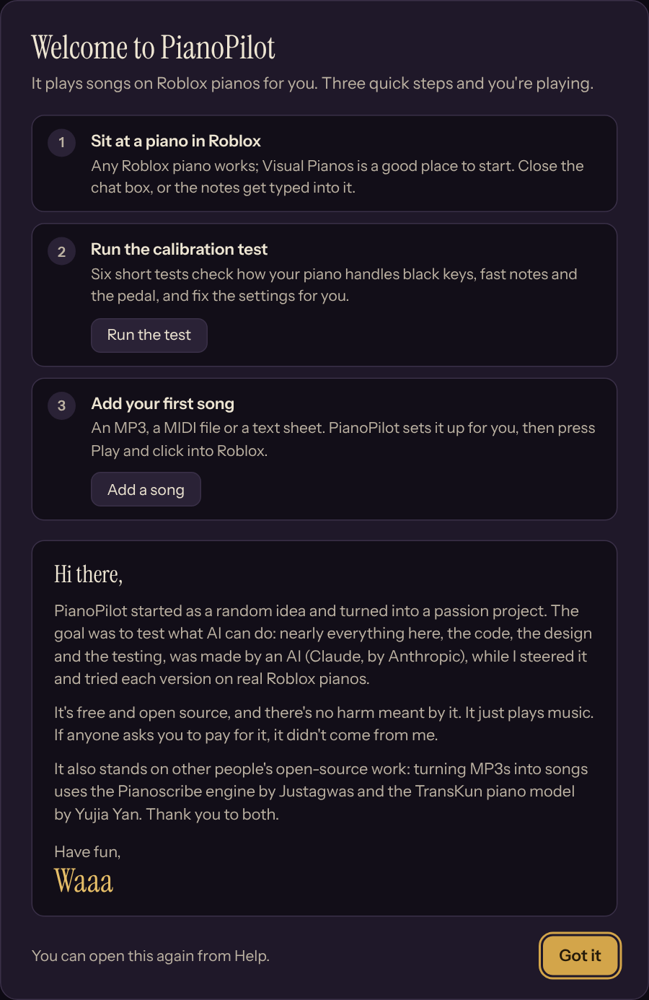

# PianoPilot

PianoPilot plays songs on Roblox pianos for you. Add an MP3 or a MIDI file, press Play, click into Roblox, and it plays the song on the piano you're sitting at. It runs on Windows, and it's free and open source.

**[Download PianoPilot 1.0](https://github.com/WaaaRBLX/PianoPilot/releases/latest)**: unzip it anywhere and double-click `PianoPilot.exe`. Nothing else to install: it brings its own Python.

> **Version 1.0 is being tested in Roblox right now.** Until it's out, the download is the 0.8 beta, which needs [Python](https://www.python.org/downloads/) 3.9 or newer installed (`PianoPilot.exe` offers to open the download page if it's missing). Everything below describes 1.0.

## What it does

- **Plays any song on a Roblox piano.** It presses the same keys you would, with accurate timing, including black keys, chords and the sustain pedal.
- **Turns MP3s and videos into songs.** Drop in a recording of piano music and it writes out the notes for you (piano-only recordings work best).
- **Takes MIDI files and text sheets** like `[tu] y o | p` as they are.
- **Best for this song.** One click picks the settings that suit the song (how it fits on the 61 keys, pedal, tracks, chord size, note length) and says what it changed. New songs get this automatically.
- **Plays like a person if you want.** Perfect, Pro, Casual or Beginner add human timing and a few mistakes.
- **Playlists, Shuffle and Smart shuffle.** Play any list (all songs, favorites, a playlist, search results) in order or shuffled. Smart shuffle plays what you like more often, skips what you just heard, and mixes in similar songs. Keep playing carries on when the queue ends.
- **Speed, loops, a queue, favorites** and a small mini player that stays on top of Roblox.
- **Never types into the wrong window.** Click out of Roblox and it pauses; click back in and it carries on.
- **A calibration test** checks how your piano handles black keys, fast notes and the pedal, and fixes the settings for you.

## Getting started

1. **Download** the zip from the [Releases page](https://github.com/WaaaRBLX/PianoPilot/releases/latest), unzip it (your Downloads folder is fine) and double-click `PianoPilot.exe`. You don't need to install Python or anything else: the download includes its own copy (the `runtime` folder).
   The first time, Windows may say "Windows protected your PC", because the app isn't signed by a known publisher. Click **More info**, then **Run anyway**. `PianoPilot.exe` is a tiny starter that runs `pianopilot.py` with the bundled Python; its source is in [`launcher/`](launcher).
2. **Follow the welcome:** sit at a piano in Roblox, close the chat box, run the calibration test, add a song, press Play and click into the Roblox window.

### Turning MP3s into songs

The first time you add an MP3, PianoPilot sets this up with one click:

- It needs the piano model file, [`PianoModel.pianoscribe`](https://downloads.justagwas.com/pianoscribe/PianoModel.pianoscribe), in your Downloads folder.
- It downloads about 150 MB of libraries (NumPy, SciPy, ONNX Runtime) into PianoPilot's own Python, so keep the PianoPilot folder somewhere that's yours, like Downloads or Documents (not Program Files). It uses your graphics card when it can.

### What you need

| | |
| --- | --- |
| **System** | Windows 10 or 11, 64-bit. Microsoft Edge (part of Windows) or Chrome shows the app window. |
| **Playing songs** | Light: about 70 MB of memory for PianoPilot plus a few hundred MB for its window, and a small share of one CPU core. Any PC that runs Roblox runs PianoPilot. |
| **Roblox** | Piano games read keys once per frame, so a steady 60 fps keeps fast notes clean. If fast songs drop notes, lower Roblox's graphics quality first. |
| **Keyboard** | Any layout (QWERTY, AZERTY, QWERTZ...). Roblox reads keys by position, and PianoPilot presses them by position. |
| **MP3 import** (optional) | Internet once, for the piano model (57 MB) and about 150 MB of libraries. A DirectX 12 graphics card (most from the last several years) makes it much faster; without one it runs on the processor, just slower. |

### Updates

Once a day, PianoPilot asks GitHub whether a newer version is out and shows a small note at the top of the song list if there is. Nothing about you or your songs is sent, and you can turn it off in Settings. To update, unzip the new download over your PianoPilot folder: your songs and settings stay. Coming from 0.8: if you used MP3 import there, PianoPilot may ask you to click **Set up** once more, and downloads the libraries again into its own Python.

### Hotkeys

These work while Roblox is in front. You can change them in Settings.

| Key | Does |
| --- | --- |
| F6 | Play and pause |
| F7 | Stop |
| Home | Back to the start |
| Page Down / Page Up | Slower / faster |
| End | Next song in the queue |

### If something sounds off

Run the calibration test (Settings) first, then press **Best for this song**. The app's Help (bottom left, or press `?`) has fixes for the common problems: black keys sounding like white keys, the camera flipping (turn off Shift Lock Switch in Roblox), and Roblox running as administrator.

## Play fair

PianoPilot is an autoplayer: it presses keys on your keyboard for you, and only while the Roblox window is in front. It doesn't touch the game itself: nothing is injected, no memory is read, no game files are changed. Some games and competitions don't allow autoplayers, so follow each game's rules, and don't pass it off as your own playing in contests.

## A note from Waaa

Hi there,

PianoPilot started as a random idea and turned into a passion project. The goal was to test what AI can do: nearly everything here, the code, the design and the testing, was made by an AI (Claude, by Anthropic), while I steered it and tried each version on real Roblox pianos.

It's free and open source, and there's no harm meant by it. It just plays music. If anyone asks you to pay for it, it didn't come from me.

It also stands on other people's open-source work: turning MP3s into songs uses the Pianoscribe engine by Justagwas and the TransKun piano model by Yujia Yan. Thank you to both.

Have fun,
**Waaa**

 

## Credits

- Audio import uses the transcription engine from [Pianoscribe](https://github.com/Justagwas/Pianoscribe) by Justagwas (GPL-3.0). See [`engine/pianoscribe_engine`](engine/pianoscribe_engine) for what was copied and what was written for PianoPilot.
- The piano model is [TransKun](https://github.com/Yujia-Yan/Transkun) by Yujia Yan (MIT).
- Fonts: Instrument Sans and Instrument Serif (SIL Open Font License), in [`ui/fonts`](ui/fonts).
- The bundled Python (`runtime`) is CPython 3.13 from [python-build-standalone](https://github.com/astral-sh/python-build-standalone), under the Python Software Foundation License; see `runtime/LICENSE.txt` in the download.
- The example songs are public domain: Beethoven's Für Elise (opening) and Bach's Prelude in C (opening), entered note by note.
- Built with [Claude](https://claude.ai) by Anthropic.

## For tinkerers

- PianoPilot is plain Python with no extra packages (MP3 import installs its own when you set it up). Running it from this repository needs Python 3.9 or newer: `python pianopilot.py` starts it, and `Start PianoPilot.bat` does the same with a command window that shows what's going on. The download on the Releases page adds the bundled Python in `runtime/`, which isn't part of the repository.
- `python piano_player.py song.mid` plays a song from the command line. Add `--help` to see the options; it also plays text sheets.
- `PianoPilot.exe` is built from [`launcher/launcher.c`](launcher/launcher.c) with clang and LLVM's Windows tools (`sh launcher/build.sh`).
- Your settings, log and the installed model live in `data/`, and your songs in `Songs/`. Both are created on first run and are never part of the repository.

## License

GPL-3.0. See [LICENSE](LICENSE). You can use, change and share PianoPilot, as long as what you share stays open source under the same license and keeps the credits.
